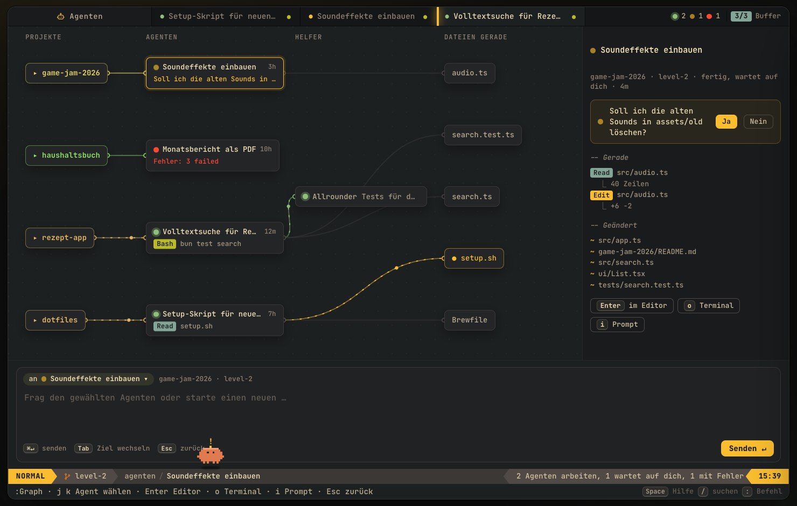
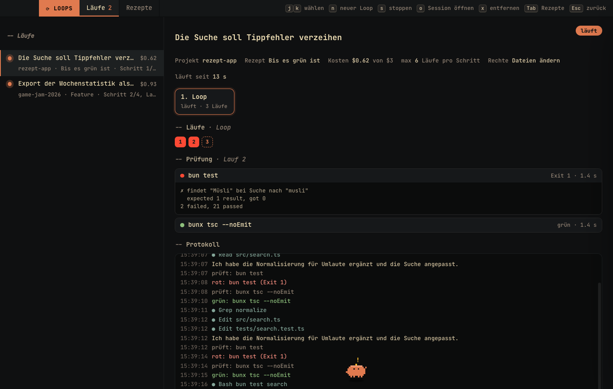
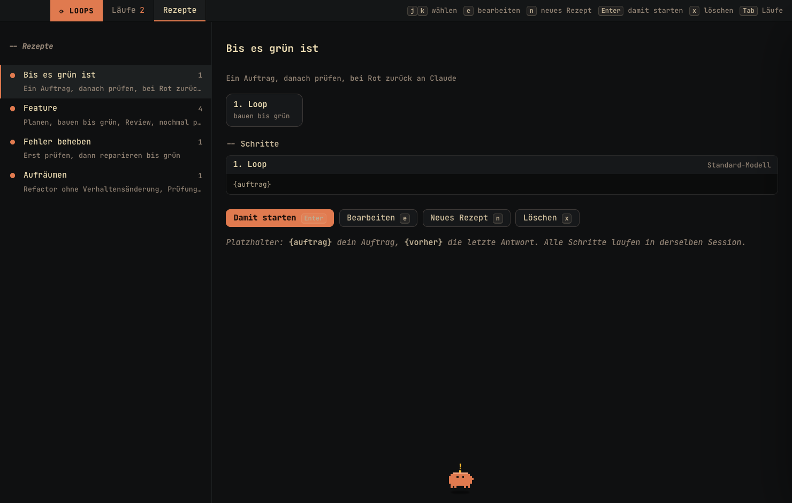
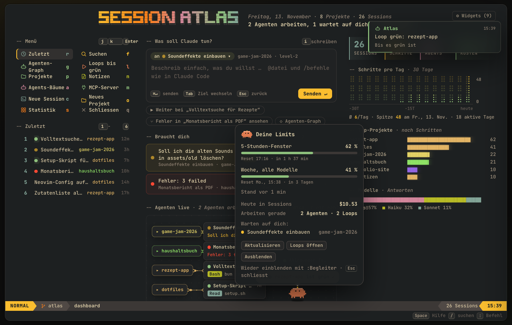
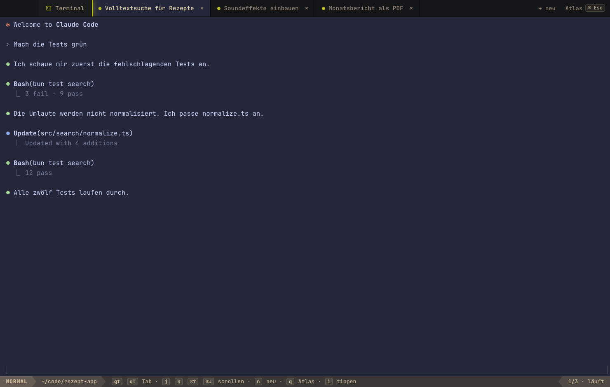

# Session Atlas

Visuelle Übersicht über die eigenen Claude-Code-Sessions: Projekte, Verlauf als Knoten, Suche, Hashtags und "hier weitermachen".

## Prototyp

```sh
node scripts/extract.mjs   # liest ~/.claude/projects, schreibt prototype/data.js (lokal, gitignored)
open prototype/index.html

# Live wie bei Orca: Daten alle 4 s neu, die Agents-Ansicht lädt sie selbst nach
node scripts/extract.mjs --watch
open "prototype/index.html#agents"
```

Die Ansicht **Agents** zeigt pro Session den Hauptagent und alle Subagents (Typ, Auftrag, Ergebnis, Werkzeuge, Dauer, Tokens), welches Modell geantwortet hat (Opus, Sonnet, Haiku …), Kosten und alle Anfragen als Zeitleiste.

Session-Inhalte werden nie committet, nur der Code.

## Desktop-App

Deine Claude-Code-Sessions als Neovim-artiger Editor: Projekte, Sessions und Schritte durchgehen, direkt weitermachen, Notizen schreiben und an Claude geben, MCP-Server verwalten. Alles lokal, nichts verlässt den Rechner.


```sh
cd app
bun install        # einmalig, kompiliert node-pty und baut den Editor
bun run start      # mit deinen echten Sessions aus ~/.claude
bun run demo       # mit erfundenen Demo-Daten (für Screenshots)
```

**Als Mac-App:** `bun run install-app` baut die App und legt sie direkt in den Programme-Ordner (vorher die laufende App mit `Cmd Q` beenden). Es bleibt keine zweite Kopie im Projektordner liegen. `bun run dist` baut nur nach `app/dist/mac-arm64/`. Die App ist nicht signiert: beim ersten Start einmal Rechtsklick → „Öffnen“.

**Dashboard:** Prompt-Feld „Was soll Claude tun?“ (`i` schreiben, `Tab` wechselt das Ziel zwischen laufenden Agenten und neuen Sessions, `Cmd Enter` schickt ab), „Braucht dich“ mit Agenten, die auf eine Antwort warten (Ja/Nein direkt beantworten), ein kleiner Live-Graph und die Statistik. Über `⚙ Widgets` schaltest du einzelne Bausteine an und aus oder wählst `kompakt`, `standard` oder `voll`.

**Agenten-Graph** (`g` auf dem Dashboard, `Space g`, `:Graph`): Projekte, Agenten, ihre Helfer und die Dateien, an denen sie gerade arbeiten, mit Linien verbunden. Grün arbeitet, gelb wartet auf dich, rot hatte einen Fehler. `j`/`k` wählt einen Agenten, rechts steht, was er zuletzt getan hat; `Enter` öffnet ihn im Editor, `o` im Terminal, `i` schreibt ihm einen Prompt. Den Zustand liest die App aus den Session-Dateien: zuletzt ein Werkzeug-Aufruf und vor weniger als 90 Sekunden geschrieben heißt „arbeitet“, eine fertige Antwort in den letzten 30 Minuten heißt „wartet auf dich“.



**Loops** (`:Loops`, `Space l`, `l` auf dem Dashboard, `:Loop <Auftrag>`): Claude arbeitet, bis alles passt. Du gibst einen Auftrag und Prüf-Befehle (Tests, Typecheck, Lint, ein eigenes Skript; die App schlägt passende aus `package.json`, `Cargo.toml` usw. vor). Claude arbeitet headless (`claude -p`), danach laufen die Prüfungen. Bei Rot geht die Fehlermeldung automatisch an dieselbe Session zurück, bis alles grün ist. Der Loop hält an bei: max. Läufe, max. Dollar, dreimal derselbe Fehler (Claude dreht sich im Kreis) oder `s`. Jeder Loop ist eine normale Session und lässt sich mit `o` im Terminal weiterführen.



**Rezepte** (`Tab` in der Loops-Ansicht, `:Rezepte`): eigene Abläufe aus Schritten, eine Zeile pro Schritt: `prompt` (ein Auftrag), `loop` (Auftrag, prüfen, bei Rot zurück), `verify` (erst prüfen, bei Rot reparieren), optional mit Modell, z. B. `loop sonnet: Setze den Plan um.` Platzhalter `{auftrag}`. Mitgeliefert: „Bis es grün ist“, „Feature“ (Plan mit Opus, bauen bis grün, Review, nochmal prüfen), „Fehler beheben“, „Aufräumen“. Gespeichert in `~/.session-atlas/recipes.json`.



**Kleiner Claude** (`:Begleiter`, `:Limits`, `Space u`): ein Pixel-Begleiter läuft über die Statuszeile und sagt ab und zu, wie viel vom 5-Stunden-Fenster und vom Wochenlimit übrig ist, wer auf dich wartet und wenn ein Loop grün wurde. Er hüpft, wenn Agenten arbeiten, winkt, wenn einer wartet, schwitzt ab 80 % Limit und schläft nachts. Klick zeigt alle Limits mit Reset-Zeit. Die Werte sind echt: jeder `claude -p`-Aufruf meldet sie mit (nur mit Abo); ohne laufenden Loop fragt die App höchstens alle 30 Minuten mit einem winzigen Haiku-Aufruf nach.



**Sessions:** Projektbaum, Fenster Sessions | Schritte | Vorschau, Vim-Bewegungen (`hjkl`, `gg`/`G`, `5j`, `Ctrl-d/u`, `{ }`, `v`/`V` + `y`), `:`-Befehle, `/` Telescope-Suche, `Space` zeigt alle Tasten. „Weitermachen“ startet `claude --resume` im eingebauten Terminal. Das Terminal füllt das ganze Fenster, `Cmd Esc` wechselt zwischen Terminal und Atlas. Scrollen ohne Maus: `Cmd ↑`/`Cmd ↓` (drei Zeilen), mit `Shift` eine Seite, `Cmd Shift Home`/`End` ganz nach oben/unten. Mehrere Terminals wechselst du mit `Cmd ]` / `Cmd [` oder `Cmd 1` bis `Cmd 9`; wie in Neovim schaltet `Ctrl Esc` (oder `Ctrl \`) in den NORMAL-Modus, dort gehen `gt`, `gT`, `3gt`, `j`/`k` und `Ctrl-d/u` zum Scrollen, `n` neues Terminal, `q` zurück zum Atlas, `i` wieder tippen. Dateien aus dem Finder ins Terminal ziehen fügt ihren Pfad ein; „Ab hier weitermachen“ startet einen Zweig (`--fork-session`), zum genauen Schritt geht es mit `/rewind`. Eine ganz neue Session startest du mit `Space c` / `:NewSession` im Projekt unter dem Cursor, oder auf dem Dashboard mit `c` (dann wählst du das Projekt).




**Notizen** (`n`, `:Notes`): Markdown mit echtem Vim-Editor (`:w`, `:q`, `dd`, `ciw` …). Notizen liegen in `~/.session-atlas/notes`, dazu die `.md`-Dateien in deinen Projektordnern. `:Anforderungen <name>` legt eine Vorlage an, `Space a` / `:Agent` gibt die Notiz an Claude: als neue Session im Projekt oder als `@datei` in die laufende Session.


**MCP** (`m`, `:Mcp`): alle MCP-Server nach Scope (user, project, local). `c` prüft den Status, `a` fügt hinzu, `dd` entfernt, immer über `claude mcp`. Env- und Header-Werte werden nie angezeigt.


Die früheren Design-Varianten (21 Looks) liegen auf dem Branch `prototype/looks`.
