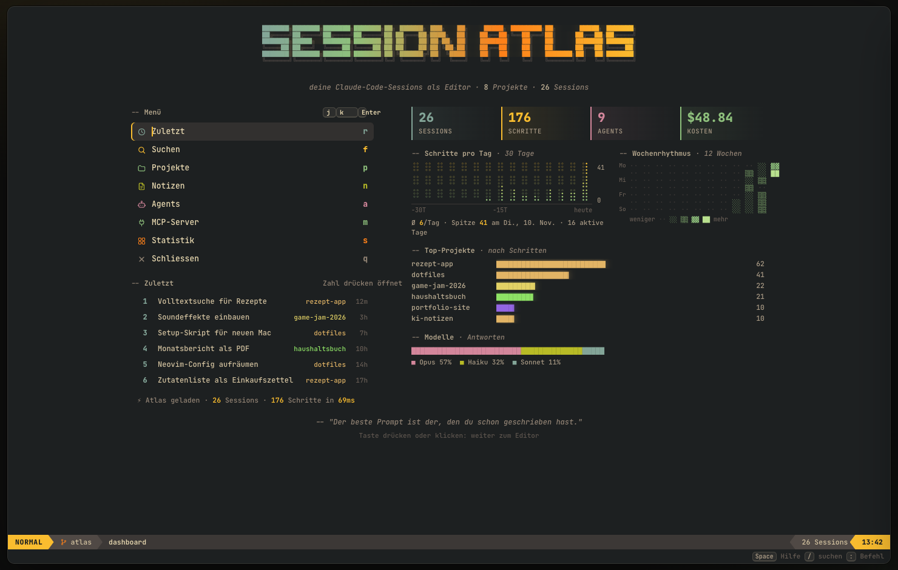
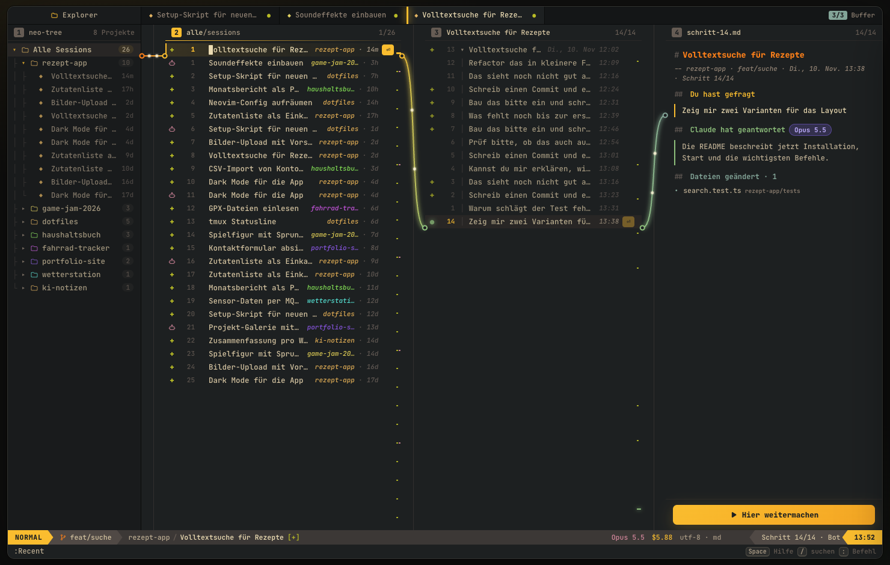
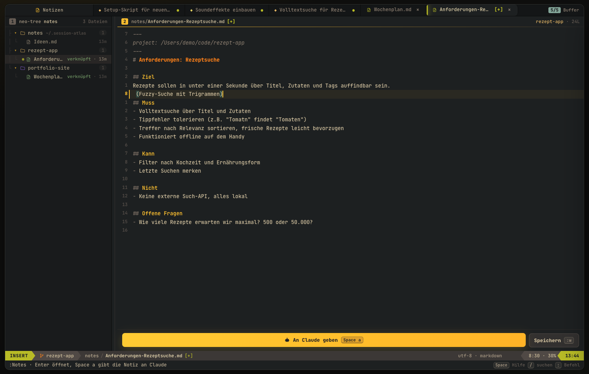
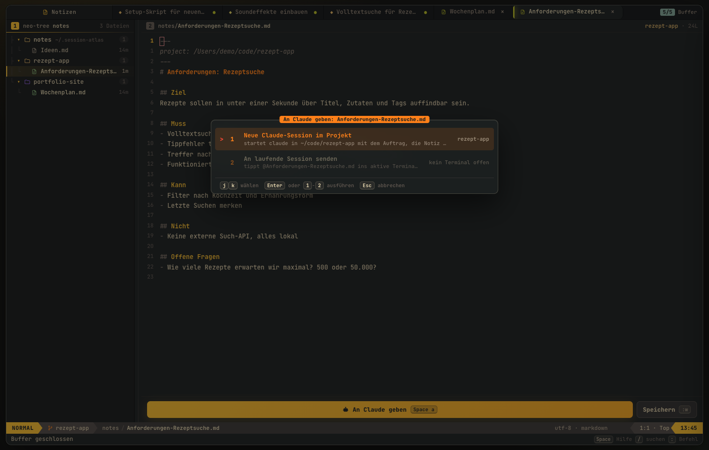
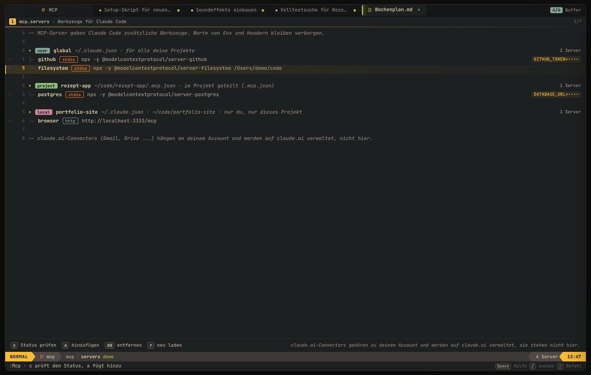

# Session Atlas

Visuelle Übersicht über die eigenen Claude-Code-Sessions: Projekte, Verlauf als Knoten, Suche, Hashtags und "hier weitermachen".

## Prototyp

```sh
node scripts/extract.mjs   # liest ~/.claude/projects, schreibt prototype/data.js (lokal, gitignored)
open prototype/index.html

# Live wie bei Orca: Daten alle 4 s neu, die Agents-Ansicht lädt sie selbst nach
node scripts/extract.mjs --watch
open "prototype/index.html#agents"
```

Die Ansicht **Agents** zeigt pro Session den Hauptagent und alle Subagents (Typ, Auftrag, Ergebnis, Werkzeuge, Dauer, Tokens), welches Modell geantwortet hat (Opus, Sonnet, Haiku …), Kosten und alle Anfragen als Zeitleiste.

Session-Inhalte werden nie committet, nur der Code.

## Desktop-App

Deine Claude-Code-Sessions als Neovim-artiger Editor: Projekte, Sessions und Schritte durchgehen, direkt weitermachen, Notizen schreiben und an Claude geben, MCP-Server verwalten. Alles lokal, nichts verlässt den Rechner.



```sh
cd app
bun install        # einmalig, kompiliert node-pty und baut den Editor
bun run start      # mit deinen echten Sessions aus ~/.claude
bun run demo       # mit erfundenen Demo-Daten (für Screenshots)
```

**Sessions:** Projektbaum, Fenster Sessions | Schritte | Vorschau, Vim-Bewegungen (`hjkl`, `gg`/`G`, `5j`, `Ctrl-d/u`, `{ }`, `v`/`V` + `y`), `:`-Befehle, `/` Telescope-Suche, `Space` zeigt alle Tasten. „Weitermachen“ startet `claude --resume` im eingebauten Terminal (`Ctrl+\``); „Ab hier weitermachen“ startet einen Zweig (`--fork-session`), zum genauen Schritt geht es mit `/rewind`.



**Notizen** (`n`, `:Notes`): Markdown mit echtem Vim-Editor (`:w`, `:q`, `dd`, `ciw` …). Notizen liegen in `~/.session-atlas/notes`, dazu die `.md`-Dateien in deinen Projektordnern. `:Anforderungen <name>` legt eine Vorlage an, `Space a` / `:Agent` gibt die Notiz an Claude: als neue Session im Projekt oder als `@datei` in die laufende Session.




**MCP** (`m`, `:Mcp`): alle MCP-Server nach Scope (user, project, local). `c` prüft den Status, `a` fügt hinzu, `dd` entfernt, immer über `claude mcp`. Env- und Header-Werte werden nie angezeigt.



Die früheren Design-Varianten (21 Looks) liegen auf dem Branch `prototype/looks`.
